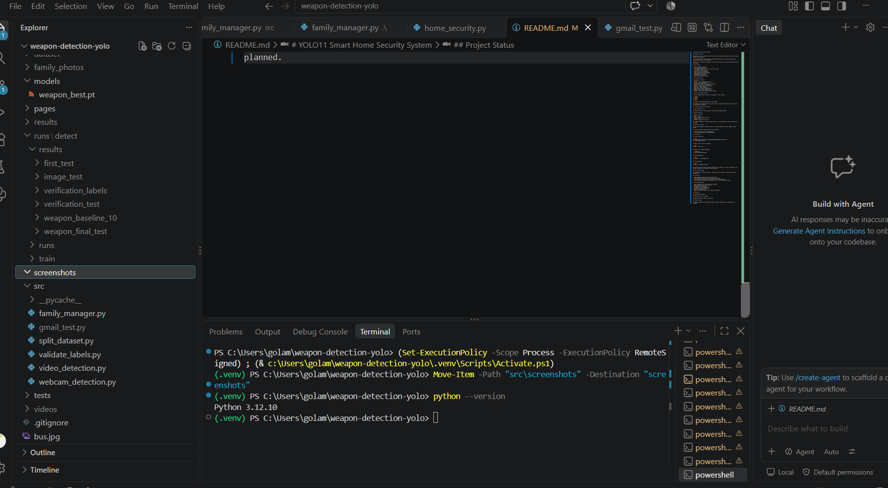
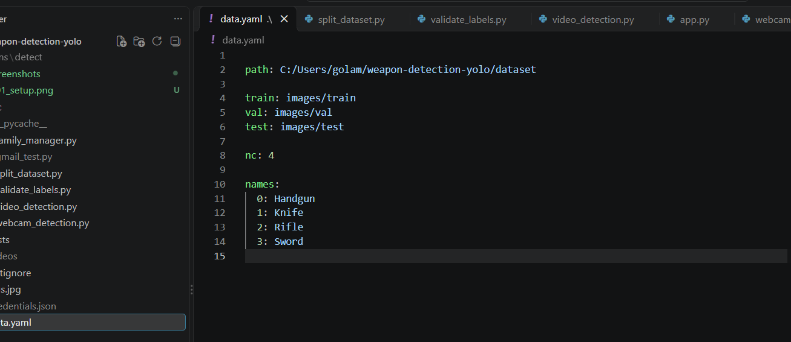
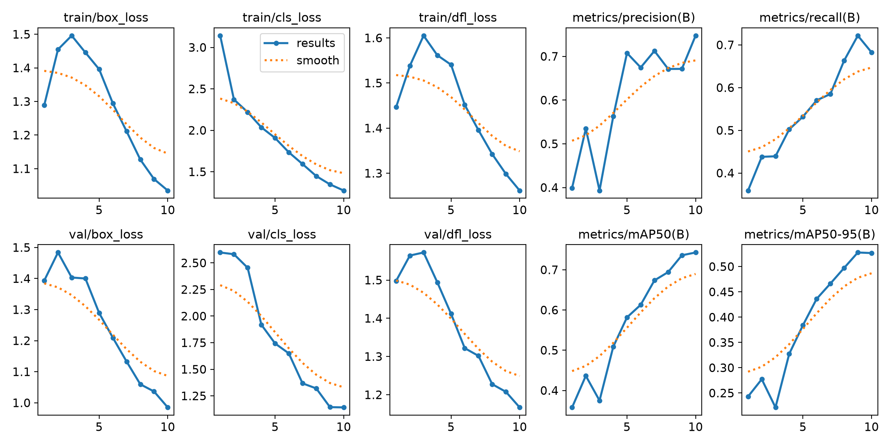
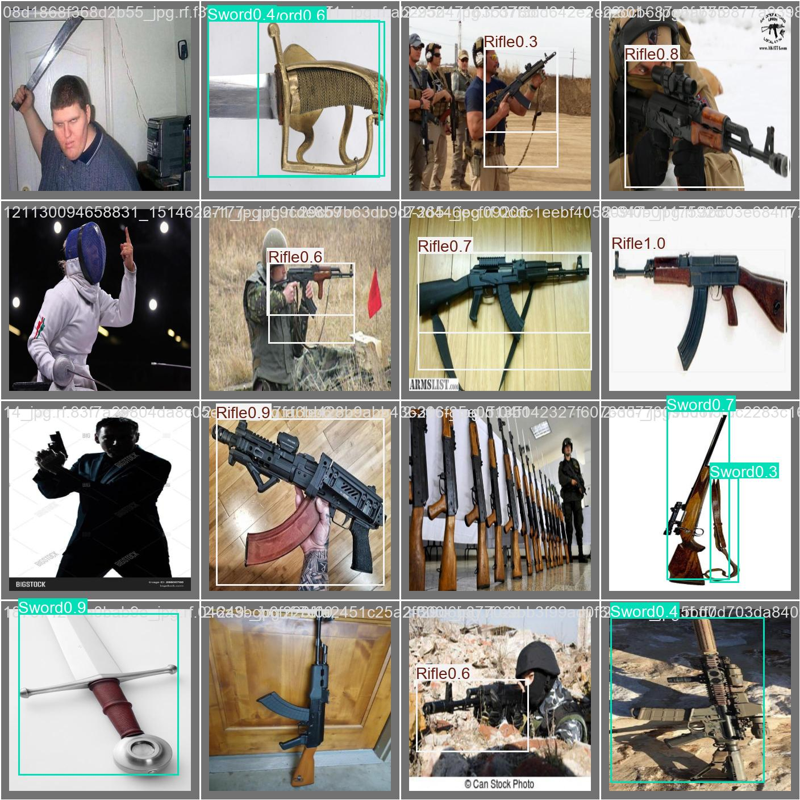
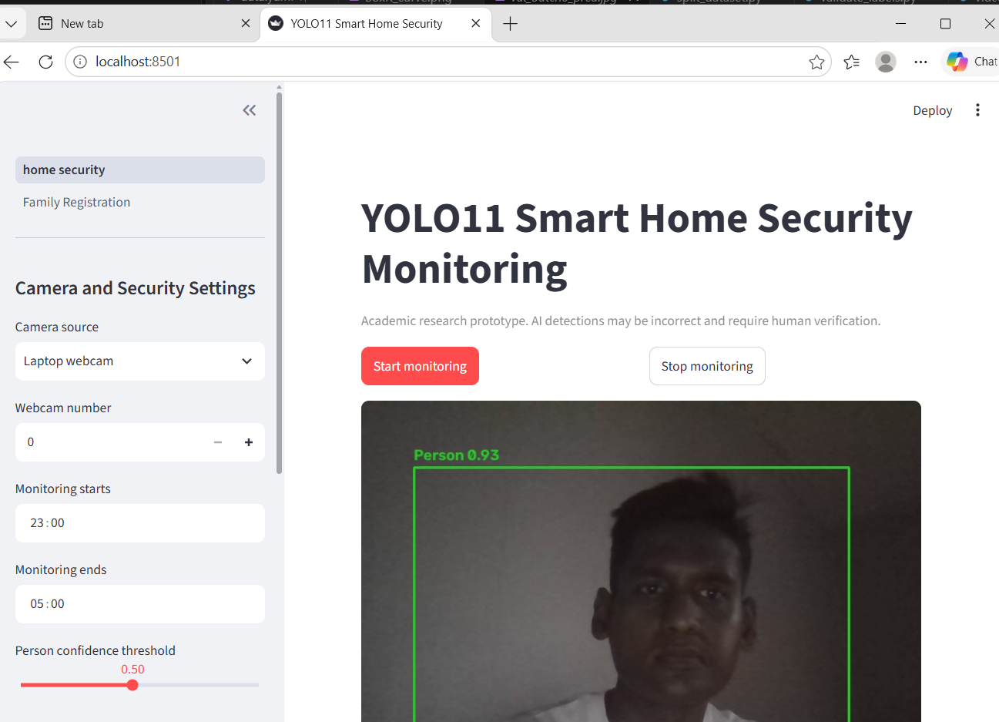
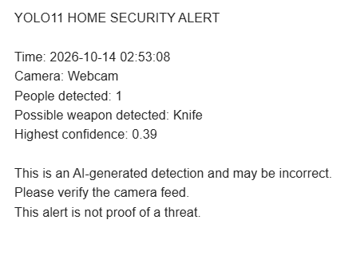

# Real-Time Weapon Detection and Smart Home Security System Using YOLO11

### AI-Powered Computer Vision | Real-Time Monitoring | Smart Home Security

A computer vision-based security system designed to detect potential weapons in camera feeds using YOLO11 object detection.

The system combines a custom-trained weapon detection model, person detection, a Streamlit monitoring dashboard, security event logging, and automated Gmail alerts.

This project demonstrates how artificial intelligence can support smart home security through real-time object detection and automated notifications.

---

## 1. Project Overview

Traditional home security cameras primarily record video and require people to review footage manually.

This project explores an AI-assisted approach that analyzes camera frames and identifies potentially dangerous objects.

The system is designed to:

- Detect potential weapons using a custom YOLO11 model.
- Identify people using a pretrained YOLO11 model.
- Process webcam video in real time.
- Display detection results through a Streamlit dashboard.
- Send Gmail security notifications.
- Record detection events for later review.
- Provide family registration and management functionality.

**Important:** This is an academic prototype. Detection results may contain false positives or missed objects and should always be reviewed by a person.

---

## 2. Project Objectives

The main objectives of this project are:

1. Develop a real-time object detection system using YOLO11.
2. Train a custom model to recognize selected weapon categories.
3. Integrate person detection with weapon detection.
4. Build an interactive monitoring interface using Streamlit.
5. Implement automated email alerts for potential security events.
6. Maintain security event records using SQLite.
7. Evaluate model performance using standard computer vision metrics.

---

## 3. Technologies Used

| Technology | Purpose |
|---|---|
| Python | Main programming language |
| YOLO11 | Object detection |
| Ultralytics | Model training and inference |
| OpenCV | Camera access and frame processing |
| Streamlit | Web-based monitoring dashboard |
| PyTorch | Deep learning framework |
| SQLite | Local event storage |
| Gmail API | Email security notifications |
| Git and GitHub | Version control |
| Visual Studio Code | Development environment |

---

## 4. System Architecture

The application follows this general workflow:

```text
Camera / Webcam
      |
      v
Video Frame Capture
      |
      v
YOLO11 Detection Pipeline
      |
      +-----------------------+
      |                       |
      v                       v
Custom Weapon Model     Person Detection Model
      |                       |
      +-----------+-----------+
                  |
                  v
          Detection Results
                  |
          +-------+-------+
          |               |
          v               v
   Streamlit UI      Event Logging
                          |
                          v
                    Gmail Alerts
```

The weapon detection and person detection models are used to support security monitoring.

---

## 5. Weapon Detection Model

A custom YOLO11 model was trained to detect four object categories.

| Class ID | Object |
|---|---|
| 0 | Handgun |
| 1 | Knife |
| 2 | Rifle |
| 3 | Sword |

### Dataset

The training dataset contains approximately **1,863 images**.

The dataset configuration uses separate training, validation, and testing directories.

Example `data.yaml` structure:

```yaml
train: images/train
val: images/val
test: images/test

nc: 4

names:
  0: Handgun
  1: Knife
  2: Rifle
  3: Sword
```

The dataset is not included in this repository.

### Model Performance

The custom weapon detection model achieved approximately:

**mAP@50: 67.5%**

This is an experimental result and should not be interpreted as a guarantee of detection accuracy in real-world environments.

Performance may vary depending on lighting, object size, camera quality, occlusion, and background conditions.

---

## 6. Person Detection

The system also uses a pretrained YOLO11 model for person detection.

The purpose of this component is to:

- Identify people visible in camera frames.
- Display person detection results.
- Provide additional context for potential security events.

Person detection does not establish a person's identity or intent.

---

## 7. Key Features

### Real-Time Weapon Detection

Analyzes camera frames and displays bounding boxes around detected objects.

### Person Detection

Identifies people using a pretrained object detection model.

### Streamlit Security Dashboard

Provides an interactive interface for monitoring detection results.

### Gmail Security Alerts

Sends automated notifications when configured detection conditions are met.

### Event Logging

Stores detection event information using SQLite.

### Family Registration

Includes functionality for registering and managing family information.

**Note:** Family registration is not the same as biometric face recognition.

---

## 8. Project Screenshots

The following screenshots are captured from the actual project development and testing process.

### Screenshot 1 — Development Environment

Python development environment and project configuration in Visual Studio Code.



### Screenshot 2 — Dataset Configuration

Dataset configuration showing the four weapon detection classes.



### Screenshot 3 — YOLO11 Training Results

Training and validation metrics generated during model training.



### Screenshot 4 — Weapon Detection Results

Example detection predictions generated by the custom YOLO11 model.



### Screenshot 5 — Streamlit Security Dashboard

Web-based monitoring interface for the smart home security application.



### Screenshot 6 — Gmail Security Alert

Example automated email notification generated during application testing.



---

## 9. Project Structure

The repository contains the main application, model files, supporting Python modules, and project documentation.

```text
weapon-detection-yolo/
|
|-- dashboard/
|-- models/
|-- pages/
|-- src/
|-- screenshots/
|   |-- 01_setup.png
|   |-- 02_dataset.png
|   |-- 03_training.png
|   |-- 04_detection.jpg
|   |-- 05_dashboard.png
|   |-- 06_gmail_alert.png
|
|-- .gitignore
|-- README.md
|-- data.yaml
|-- family_manager.py
|-- home_security.py
|-- requirements.txt
|-- yolo11n.pt
```

Some training outputs, private configuration files, and local datasets are excluded from the public repository.

---

## 10. Installation and Setup

### Step 1 — Clone the Repository

```bash
git clone https://github.com/torjoymorshad/weapon-detection-yolo.git
cd weapon-detection-yolo
```

### Step 2 — Create a Virtual Environment

On Windows:

```powershell
python -m venv .venv
```

Activate it:

```powershell
.venv\Scripts\Activate.ps1
```

### Step 3 — Install Dependencies

```powershell
pip install -r requirements.txt
```

### Step 4 — Configure the Models

Ensure the required model files are available in the expected locations.

The application uses:

- A custom-trained YOLO11 weapon detection model.
- A pretrained YOLO11 person detection model.

Some model files may need to be provided separately.

### Step 5 — Configure Gmail Notifications

The Gmail notification feature requires Google API credentials and authorization.

Private authentication files must be stored locally and should never be uploaded to GitHub.

### Step 6 — Run the Application

```powershell
streamlit run home_security.py
```

Open the local Streamlit URL displayed in the terminal.

**Note:** A complete setup may require additional local configuration for model paths, Gmail authentication, and database initialization.

---

## 11. Testing and Evaluation

The project was evaluated using model training results and application-level testing.

Testing activities included:

- Training a custom YOLO11 model.
- Reviewing model prediction outputs.
- Running webcam-based detection.
- Testing the Streamlit monitoring dashboard.
- Checking person detection functionality.
- Testing Gmail security notifications.
- Reviewing event logging behavior.

A Gmail alert was successfully generated during webcam testing for a possible knife detection.

This demonstrates the notification workflow, but does not establish production-level reliability.

---

## 12. Current Limitations

The system has several limitations:

1. **False positives:** Everyday objects may occasionally be classified incorrectly.
2. **False negatives:** Some target objects may not be detected.
3. **Lighting conditions:** Poor lighting may reduce detection performance.
4. **Camera quality:** Low-resolution frames can affect predictions.
5. **Object visibility:** Small or partially hidden objects may be difficult to detect.
6. **Dataset coverage:** Model performance depends on the diversity and quality of training data.
7. **Generalization:** Performance on unfamiliar environments may differ from test results.
8. **Alert reliability:** Notifications depend on application configuration and network availability.

The system is intended for research and demonstration rather than autonomous emergency decision-making.

---

## 13. Future Improvements

Planned improvements include:

- Expanding and improving the training dataset.
- Evaluating performance on more challenging test images.
- Reducing false-positive detections.
- Optimizing inference speed.
- Improving the Streamlit dashboard.
- Adding structured detection analytics.
- Improving event history and reporting.
- Developing a FastAPI inference service.
- Testing deployment options for remote monitoring.
- Improving authentication and privacy protections.
- Adding configurable alert thresholds.
- Evaluating the system using additional precision, recall, and mAP metrics.

---

## 14. Research and Learning Outcomes

This project provides practical experience in:

- Computer vision.
- Deep learning.
- Object detection.
- Dataset preparation.
- YOLO model training.
- Model evaluation.
- Python application development.
- Real-time video processing.
- Web dashboard development.
- API integration.
- Database management.
- GitHub project documentation.

It also provides a foundation for future research in AI-assisted security monitoring and intelligent surveillance systems.

---

## 15. Privacy and Responsible Use

This project should be used responsibly.

- Obtain permission before